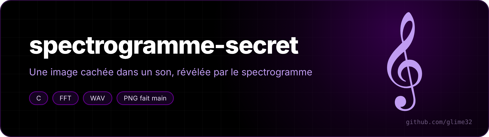
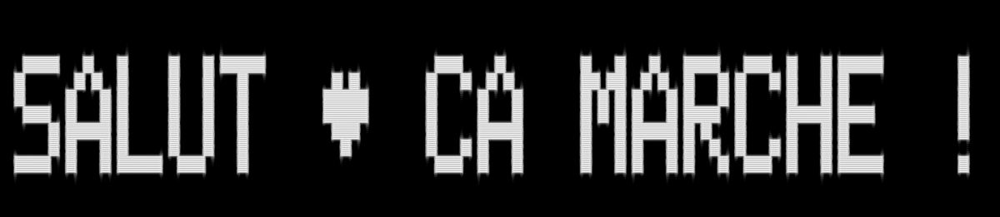
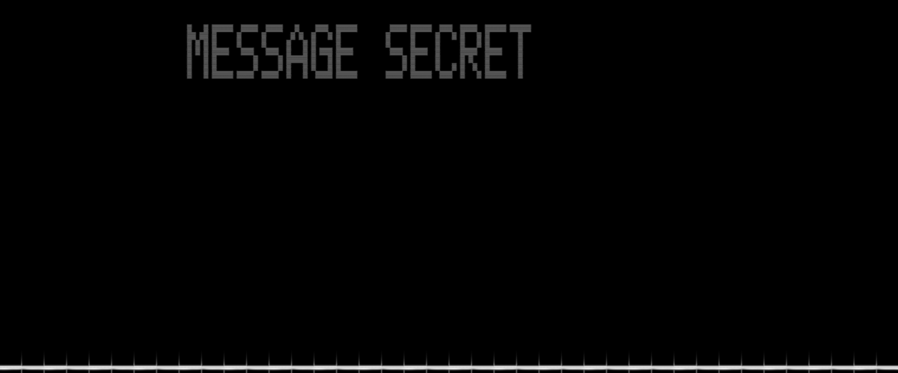

<p align="center"></p>

<p align="center"> </p>

Cacher une image ou un texte **dans le son lui-même** : on ne l'entend pas comme un message, mais dès qu'on affiche le spectrogramme (Audacity, Sonic Visualiser, ou l'outil lui-même), l'image apparaît.

<p align="center"><a href="README.md">🇬🇧 English version</a></p>



Le même principe, mélangé discrètement dans une musique, entre 15 et 19,5 kHz (des fréquences que la plupart des adultes n'entendent presque plus) :



En bas : la musique (graves). En haut : le message, invisible à l'oreille.

## Compiler

```sh
make
./tests.sh     # cache des damiers, les fait réapparaître et vérifie chaque quart de l'image
```

Seulement du C et la libm : FFT, lecture/écriture WAV, PGM et PNG sont écrits à la main.

## Utilisation

```sh
# un texte (accents et ♥ acceptés) dans un son à part
./spectro cacher -t "Salut ♥ ça marche !" -o message.wav

# une image dans une musique existante, à partir de la 3e seconde
magick photo.jpg photo.pgm            # l'outil lit le PGM/PPM
./spectro cacher -i photo.pgm --dans musique.wav --debut 3 -o piege.wav

# faire réapparaître l'image
./spectro reveler -i piege.wav -o image.png --fmin 15000 --fmax 19500
```

Options utiles : `--fmin/--fmax` (bande utilisée), `--duree`, `--gain` (discrétion du mélange), `--fft` et `--saut` (résolution du spectrogramme), `--dyn` (contraste en dB). `./spectro --aide` pour tout voir.

## Comment ça marche

**Cacher (synthèse additive).** Chaque ligne de l'image devient une sinusoïde : la ligne du haut a la fréquence `fmax`, celle du bas `fmin`. Le temps parcourt l'image de gauche à droite, et l'amplitude de chaque sinusoïde suit la luminosité du pixel courant (interpolée entre deux colonnes pour éviter les clics). Un spectrogramme affiche des **décibels**, donc la luminosité est convertie en échelle logarithmique : `a = 10^((p − 1)·40/20)`.

Pour ne pas appeler `sin()` des millions de fois, la phase de chaque ligne avance par un *phaseur* : on multiplie un nombre complexe `(cos φ, sin φ)` par la rotation fixe `e^{iω}` à chaque échantillon, et on le renormalise de temps en temps pour qu'il ne dérive pas. Chaque ligne part d'une phase aléatoire, sinon toutes les sinusoïdes s'additionnent en un énorme pic au début.

**Révéler (transformée de Fourier à court terme).** On découpe le son en fenêtres de `N` échantillons (2048 par défaut) qui se chevauchent, on multiplie chacune par une fenêtre de Hann, et on calcule sa FFT (radix 2, itérative, avec permutation par inversion des bits). La magnitude de chaque fréquence, en dB, devient un niveau de gris ; chaque fenêtre donne une colonne de l'image.

**Compromis temps / fréquence.** Une grande FFT sépare mieux les fréquences (`taux / N` Hz par case) mais brouille le temps, et inversement : c'est pour ça que `--fft` et `--saut` sont réglables.

**PNG sans bibliothèque.** Le PNG est écrit avec des blocs deflate « stockés » (non compressés) : il suffit d'ajouter les en-têtes, le CRC-32 de chaque bloc et la somme Adler-32 de zlib.

## Limites

- Les MP3 coupent souvent au-dessus de 16 kHz : l'image cachée dans les aigus ne survit pas toujours à une compression. Garder du WAV, ou cacher plus bas (`--fmin 9000 --fmax 14000`) au prix de la discrétion.
- Images en entrée : PGM/PPM uniquement (une ligne `magick` convertit n'importe quoi).
