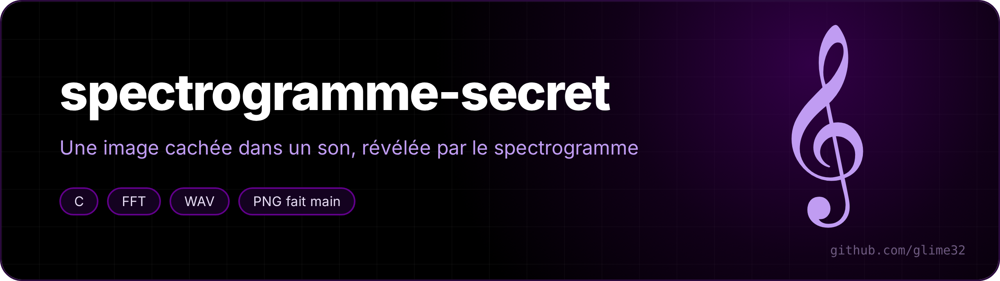
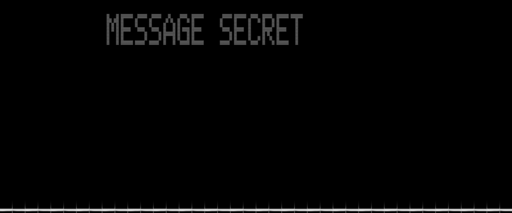

<p align="center"></p>

<p align="center"> </p>

Hide a picture or some text **inside the sound itself**: you don't hear it as a message, but as soon as you look at the spectrogram (Audacity, Sonic Visualiser, or the tool itself), the picture shows up.

<p align="center"><a href="README.fr.md">🇫🇷 Version française</a></p>


Same idea, quietly mixed into a song between 15 and 19.5 kHz (frequencies most adults can barely hear any more):



Bottom: the music (low frequencies). Top: the message, inaudible.

## Build

```sh
make
./tests.sh     # hides checkerboards, reveals them and checks each quarter of the image
```

Only C and libm: the FFT and the WAV, PGM and PNG readers/writers are written by hand.

## Usage

The command names are French: `cacher` = hide, `reveler` = reveal, `--dans` = into, `--debut` = start.

```sh
# some text (accents and ♥ work) in a sound of its own
./spectro cacher -t "Salut ♥ ça marche !" -o message.wav

# a picture inside an existing song, starting at second 3
magick photo.jpg photo.pgm            # the tool reads PGM/PPM
./spectro cacher -i photo.pgm --dans musique.wav --debut 3 -o piege.wav

# bring the picture back
./spectro reveler -i piege.wav -o image.png --fmin 15000 --fmax 19500
```

Useful options: `--fmin/--fmax` (frequency band), `--duree` (duration), `--gain` (how quiet the mix is), `--fft` and `--saut` (spectrogram resolution and hop), `--dyn` (contrast in dB). `./spectro --aide` lists everything.

## How it works

**Hiding (additive synthesis).** Each row of the picture becomes a sine wave: the top row has frequency `fmax`, the bottom row `fmin`. Time walks through the picture from left to right, and the amplitude of each sine follows the brightness of the current pixel (interpolated between two columns to avoid clicks). A spectrogram shows **decibels**, so brightness is mapped to a log scale: `a = 10^((p − 1)·40/20)`.

To avoid calling `sin()` millions of times, the phase of each row moves forward with a *phasor*: a complex number `(cos φ, sin φ)` is multiplied by the fixed rotation `e^{iω}` at every sample, and renormalised now and then so it doesn't drift. Each row starts at a random phase, otherwise all the sines add up into one huge spike at the start.

**Revealing (short-time Fourier transform).** The sound is cut into overlapping windows of `N` samples (2048 by default), each one is multiplied by a Hann window, and its FFT is computed (radix 2, iterative, with bit-reversal permutation). The magnitude of each frequency, in dB, becomes a grey level; each window gives one column of the image.

**Time / frequency trade-off.** A large FFT separates frequencies better (`rate / N` Hz per bin) but blurs time, and the other way round: that's why `--fft` and `--saut` can be tuned.

**PNG without a library.** The PNG is written with "stored" (uncompressed) deflate blocks: you only need the headers, the CRC-32 of each chunk and zlib's Adler-32 checksum.

## Limits

- MP3 often cuts everything above 16 kHz: a picture hidden in the highs doesn't always survive compression. Keep WAV, or hide it lower (`--fmin 9000 --fmax 14000`) at the cost of being less discreet.
- Input pictures: PGM/PPM only (one `magick` line converts anything).
